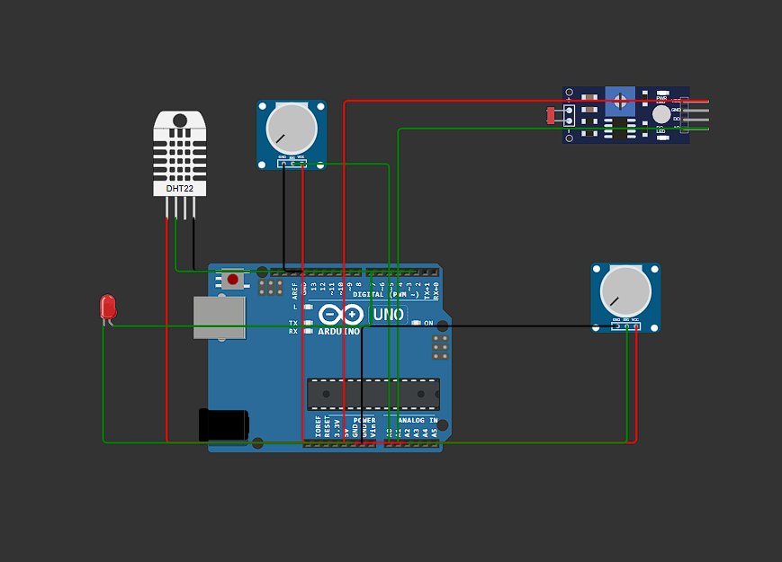
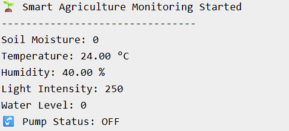
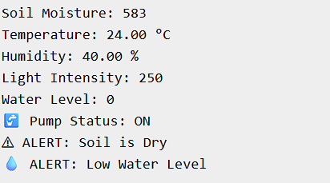
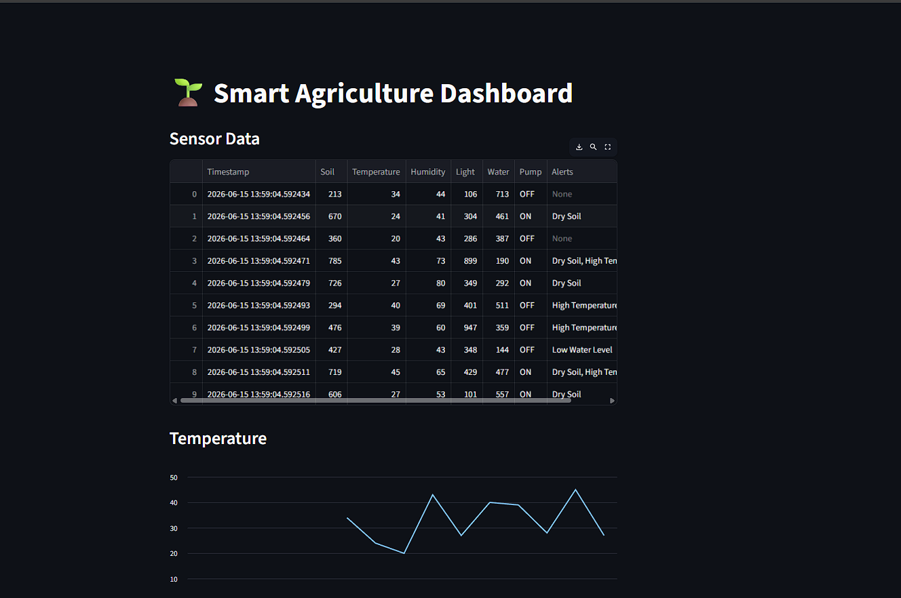

# 🌱 IoT-Enabled Smart Agriculture Monitoring System

An industry-oriented IoT project for monitoring agricultural conditions using sensors, automation logic, Wokwi simulation, Python-based analytics, Streamlit dashboard, and irrigation control.

This project demonstrates how IoT can improve farming efficiency through **real-time monitoring, smart irrigation, alerts, and data logging**.

---

# 📌 Project Overview

Traditional farming often suffers from:

- Water wastage
- Manual irrigation
- Late crop monitoring
- Temperature-related crop damage
- Lack of automation

This project solves these problems using:

✅ Soil Moisture Monitoring  
✅ Temperature & Humidity Monitoring  
✅ Light Intensity Monitoring  
✅ Water Level Monitoring  
✅ Smart Irrigation Logic  
✅ Pump ON/OFF Automation  
✅ Real-Time Dashboard  
✅ Alert Generation  
✅ CSV Data Logging

---

# 🎯 Problem Statement

Farmers often irrigate crops manually without knowing the actual soil condition, which leads to:

- Overwatering
- Underwatering
- Crop damage
- Resource wastage

The **IoT Smart Agriculture Monitoring System** helps monitor field conditions and automatically makes irrigation decisions based on sensor readings.

---

# 🏗 System Architecture

## Architecture Flow

```text
Sensors
   ↓
Arduino / ESP32
   ↓
Sensor Data Processing
   ↓
Threshold Checking
   ↓
Pump Decision
   ↓
Dashboard + Alerts
   ↓
CSV Data Logging
```

---

# ⚙️ Features

### 🌡 Environmental Monitoring
- Temperature monitoring
- Humidity monitoring
- Soil moisture detection
- Light intensity sensing
- Water tank level detection

### 🚰 Smart Irrigation
- Automatic pump ON/OFF
- Dry soil detection
- Water-saving logic

### ⚠️ Alert System
- Dry soil alert
- High temperature alert
- Low water level alert

### 📊 Dashboard
- Live sensor monitoring
- Graphical visualization
- Historical data analysis

### 📝 Data Logging
- CSV-based storage
- Sensor report generation

---

# 🧰 Tech Stack

## Hardware / Simulation
- Arduino UNO
- DHT11/DHT22 Sensor
- Soil Moisture Sensor
- LDR Sensor
- Water Level Sensor
- Relay/Pump Simulation
- Wokwi Simulator

## Software
- Python
- Streamlit
- Pandas
- Matplotlib
- Arduino IDE


---

# 🔌 Components Used

| Component | Purpose |
|-----------|----------|
| Arduino UNO | Controller |
| DHT11/DHT22 | Temperature & Humidity |
| Soil Moisture Sensor | Soil Monitoring |
| LDR | Light Intensity |
| Water Level Sensor | Tank Monitoring |
| LED (Pump Simulation) | Irrigation Simulation |

---

# 🌐 Wokwi Circuit Simulation

## Circuit Diagram



This circuit was designed and tested virtually using **Wokwi**, enabling simulation without physical hardware.

---

# 🖥 Serial Monitor Output

## Sensor Monitoring



The serial monitor displays:

- Soil moisture
- Temperature
- Humidity
- Light intensity
- Water level
- Pump status
- Alerts

---

# 🚨 Dry Soil Alert

When soil moisture crosses the threshold:

- Pump turns ON
- Alert generated



---

# 🚰 Pump Automation

## Pump ON

When soil becomes dry:


## Pump OFF

When soil becomes sufficiently wet:


---

# 📊 Streamlit Dashboard

The Streamlit dashboard visualizes sensor data.

Features:
- Live data table
- Temperature graph
- Soil moisture graph
- Humidity graph

## Dashboard Preview



---

# 📄 CSV Data Logging

Sensor data is logged into CSV for analysis.

## CSV Output


---

# ▶️ How to Run the Project

## Step 1: Clone Repository

```bash
git clone YOUR_REPOSITORY_LINK
```

---

## Step 2: Install Dependencies

```bash
pip install -r requirements.txt
```

---

## Step 3: Run Python Simulation

```bash
python main.py
```

This generates:

```text
data/sensor_data.csv
```

---

## Step 4: Run Dashboard

```bash
streamlit run dashboard/app.py
```

---

## Step 5: Run Wokwi Simulation

1. Open Wokwi  
2. Upload Arduino code  
3. Start simulation  
4. Open Serial Monitor  

---

# 📈 Sample Output

```text
Soil Moisture: 720
Temperature: 38°C
Humidity: 62%
Water Level: 120

⚠ ALERT: Soil is Dry
🚰 Pump Status: ON
🔥 ALERT: High Temperature
💧 ALERT: Low Water Level
```

---

# 🧠 IoT Concepts Demonstrated

This project demonstrates:

- IoT Architecture
- Sensor Integration
- Embedded Systems
- Automation Logic
- Smart Irrigation
- Dashboard Visualization
- Data Logging
- Alert Systems

---

# 🎓 Learning Outcomes

Through this project, I learned:

- Arduino Programming
- Sensor Interfacing
- Threshold Logic
- IoT Workflow
- Streamlit Dashboard Development
- CSV Data Logging
- GitHub Project Documentation
- Wokwi Virtual Simulation

---

# 🔮 Future Enhancements

- ESP32 Cloud Integration
- MQTT Communication
- ThingSpeak Analytics
- Mobile Notifications
- AI-Based Crop Prediction
- Smart Weather-Based Irrigation

---

# 🔗 Wokwi Simulation Link

[Click Here to Open Simulation](https://wokwi.com/projects/466883931248686081)

---

# 🏷 GitHub Tags

```text
iot
smart-agriculture
arduino
esp32
streamlit
python
automation
embedded-systems
smart-farming
wokwi
```
